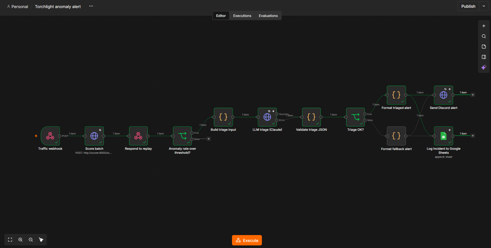
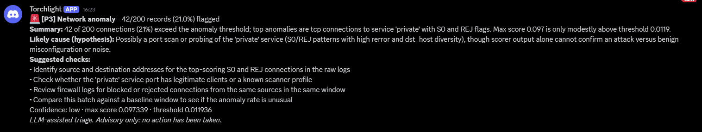
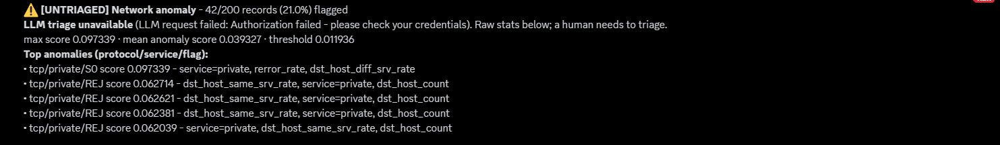
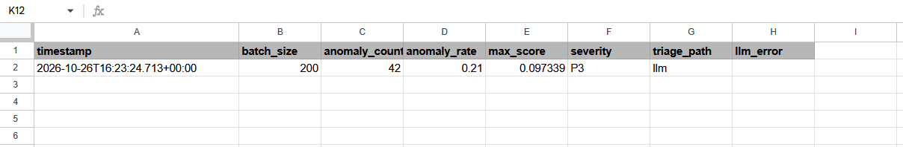
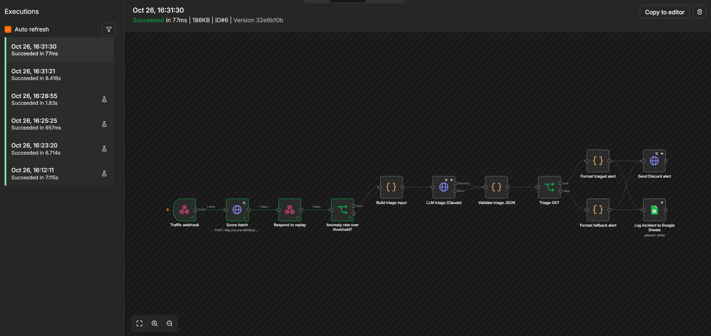

# Torchlight

An AI-native network incident pipeline. A PyTorch autoencoder flags anomalous network traffic, n8n runs the workflow, and Claude turns the raw anomalies into a triaged, human-readable incident alert on Discord. Each incident is also logged to Google Sheets.

**The LLM advises, it never acts.** Nothing is remediated automatically, and a human reads every alert. If the LLM is down, the alert still goes out.

```
replay.py --POST--> n8n Webhook --> HTTP Request --> FastAPI /score (PyTorch autoencoder)
                                                          |
         n8n IF (anomaly_rate >= ALERT_MIN_RATE) <--------+
             |-- false: stop (no alert, no LLM call)
             '-- true: build compact, whitelisted summary
                        --> Claude (HTTP Request, 20s timeout, 1 retry, structured JSON output)
                        --> validate JSON (keys, severity P1-P4)
                              |-- ok:     Discord alert: severity, summary, likely cause, checks
                              '-- failed: Discord alert: raw stats + "LLM triage unavailable"
                        --> append row to Google Sheets

FastAPI /metrics --> (optional) Prometheus --> Grafana
```

## Results (NSL-KDD, KDDTest+)

The autoencoder is trained on **normal rows only**. Each record's score is its reconstruction error, and the threshold is a percentile of the error on held-out normal training data.

| Threshold | Precision | Recall | F1 | False-positive rate on test normals |
|---|---|---|---|---|
| p95 | 0.924 | 0.877 | 0.900 | 9.6% |
| **p99 (chosen)** | **0.966** | **0.596** | **0.737** | **2.8%** |
| p99.9 | 0.977 | 0.468 | 0.632 | 1.4% |

`python src/train.py` reproduces these numbers (seed 42, 30 epochs, about 25 s on CPU) and writes them to `artifacts/meta.json`.

**Why p99:** when an alert fires, it is almost always real (97% precision). p95 would catch about 28 points more attacks, but would flag almost 1 in 10 normal connections, which is classic alert fatigue. p99.9 loses a lot of recall and gains almost no precision. The threshold is the one knob deliberately left exposed: `--percentile`.

Note the gap between the 1% false-positive rate on validation and 2.8% on test. KDDTest+ normal traffic is distributed differently from KDDTrain+, a small taste of real-world drift.

### Screenshots


*The full n8n workflow: webhook, scorer call, rate gate, Claude triage, JSON validation, then either the triaged or the fallback alert, with Discord and Google Sheets at the end. Both alert variants feed the same two sinks, so the incident log is written whichever path ran.*


*A triaged alert for an attack-heavy batch of 200 records, 42 of them flagged: severity P3, a summary, a hedged likely cause, four suggested checks and a confidence level. It ends with a line stating the triage is advisory and no action has been taken.*


*The same batch with the Anthropic credential deliberately broken: the alert still goes out, marked UNTRIAGED, with the LLM error and the raw scorer stats. This is the graceful-degradation path, and a human is told plainly that they need to do the triage.*


*One row is appended per alerted batch, recording the timestamp, batch size, anomaly count and rate, max score, severity and whether the LLM or the fallback path was used. Here `triage_path` is `llm` and `llm_error` is empty.*


*The executions list, with the latest run (a normal-only batch) selected. It stops at the "Anomaly rate over threshold?" node and takes the false branch, so there is no LLM call, no alert and no log row.*


*The Prometheus counters from `/metrics` (requests, records scored, anomalies, latency histogram count) above the scorer's structured JSON log lines. Each log line carries the batch size, anomaly count and latency in milliseconds, and most requests complete in under 30 ms.*

## Quick start

```bash
python -m venv .venv && source .venv/bin/activate
pip install torch --index-url https://download.pytorch.org/whl/cpu   # small CPU-only build
pip install -r requirements.txt

# Data: KDDTrain+.txt and KDDTest+.txt into data/
mkdir -p data && for f in KDDTrain+.txt KDDTest+.txt; do
  curl -sSfL -o "data/$f" "https://raw.githubusercontent.com/defcom17/NSL_KDD/master/$f"; done

python src/train.py --data-dir data --epochs 30 --percentile 99   # writes artifacts/
pytest -q                                                          # API + workflow tests

cp .env.example .env            # fill in DISCORD_WEBHOOK_URL and GOOGLE_SHEET_ID
docker compose up --build       # scorer :8000, n8n :5678
```

You can test the scorer without n8n:

```bash
curl localhost:8000/health
python src/replay.py --webhook http://localhost:8000/score --n 200 --attack-ratio 0.3
```

### n8n setup (one-off, in the UI at http://localhost:5678)

1. **Import** `workflows/anomaly_alert.json` (Workflows → Import from file).
2. **Anthropic credential:** open the *LLM triage (Claude)* node → Credential → *Create new* → paste your API key. The key lives only in n8n's encrypted credential store, never in the repo or `.env`.
3. **Google Sheets:** create a sheet with a tab named `incidents` and this header row:
   `timestamp | batch_size | anomaly_count | anomaly_rate | max_score | severity | triage_path | llm_error`.
   Put its ID (the long string in the sheet URL) in `.env` as `GOOGLE_SHEET_ID`. Then open the *Log incident to Google Sheets* node and connect a Google Sheets OAuth2 credential.
4. **Discord:** Server settings → Integrations → Webhooks → New webhook → copy the URL into `.env` as `DISCORD_WEBHOOK_URL`. Restart n8n afterwards (`docker compose up -d`).
5. Test with the editor listening (`/webhook-test/`), then **publish/activate** the workflow and use `/webhook/`:

```bash
python src/replay.py --webhook http://localhost:5678/webhook/traffic --n 200 --attack-ratio 0.3  # alert
python src/replay.py --webhook http://localhost:5678/webhook/traffic --n 200 --attack-ratio 0    # no alert
```

| Env var (`.env`) | Purpose | Default |
|---|---|---|
| `DISCORD_WEBHOOK_URL` | Where alerts go | required |
| `GOOGLE_SHEET_ID` | Incident log sheet | required |
| `ALERT_MIN_RATE` | Fraction of a batch that must be anomalous to alert | `0.10` |
| `ANTHROPIC_MODEL` | Triage model | `claude-haiku-5-5` |

## What was tested

Everything below ran against the real compose stack (scorer + n8n 2.44.6). A local mock stood in for the Discord and Anthropic endpoints, because the build sandbox had no real keys:

| Scenario | Result |
|---|---|
| 30% attack batch, LLM healthy | `[P2]` triaged alert; request carried the `x-api-key` + `anthropic-version` headers and the JSON schema |
| Normal-only batches (3 seeds) | 5-9 records flagged (2.5-4.5%), below the 10% gate → **no alert, no LLM call** |
| LLM returns non-JSON | Fallback alert: "LLM reply was not valid JSON" |
| LLM returns HTTP 500 | 2 attempts, then fallback alert |
| LLM hangs | Timed out at 20 s, retried once, fallback alert after ~43 s |
| Anthropic credential removed | Fallback alert: "Credentials not found" |
| `/metrics` | `requests_total`, `records_scored_total`, `anomalies_total`, `score_latency_seconds` histogram |
| Bad input to `/score` | `422` (every one of the 41 features is required and typed) |

## Design decisions and trade-offs

- **Why unsupervised:** labelled attacks are rare and keep changing, while normal behaviour is plentiful. Training on normal traffic only means new attack types (KDDTest+ contains attack types never seen in training) can still look anomalous.
- **Preprocessing:** byte counts are heavy-tailed, so numeric features get `log1p` followed by min-max scaling to [0, 1]. Standard scaling gave rare-but-normal values huge z-scores, which pushed p99 recall down to 33%. Bounded features fixed that without touching the model. The preprocessor is fitted on normal training rows only and reused by the API (`preprocessor.joblib`), so training and serving can't drift apart.
- **Alert gate on anomaly *rate*, not `anomaly_count > 0`:** even at a 2.8% false-positive rate, a 200-record batch of pure normal traffic almost always has a few flagged records (19 of 20 batches in testing). Alerting on "any anomaly" would page someone on nearly every batch. Gating on ≥10% of the batch separates normal batches (median 2.2%, max 6.5%) from attack-heavy ones (16-22.5%). The scorer still reports every flagged record; only the paging decision is batched. It has real blind spots, measured in [The rate gate's blind spots](#the-rate-gates-blind-spots).
- **Alert-fatigue controls:** batching, the rate gate, and calling the LLM once per *anomalous batch* (never per record) keep cost, latency and noise down.
- **Graceful degradation:** the LLM has a 20 s timeout and 1 retry, and its error output is wired into the same validation step. Any failure (timeout, 5xx, bad JSON, wrong severity, missing credential) produces the fallback alert with raw stats. The alert path never depends on the LLM.
- **HTTP Request node instead of Basic LLM Chain:** n8n's Anthropic Chat Model node has no timeout setting (the SDK default is 10 minutes), which would break the 20 s budget. Calling the Messages API directly gives a hard timeout and still uses n8n's Anthropic credential type, so the key is still stored by n8n.
- **Structured output + validation:** the request uses `output_config.format` with a JSON schema, so the API itself constrains the reply. The workflow still validates it (defence in depth): severity must be P1-P4, confidence low/medium/high, checks a non-empty list. Text fields are length-capped.
- **Prompt injection:** network-derived fields are untrusted input. Only whitelisted, compact fields reach the LLM (counts, scores, protocol/service/flag, top features), stripped to `[A-Za-z0-9_=.-]` and capped at 40 characters. They are wrapped in `<scorer_output>` tags, and the system prompt tells the model to treat them as data. Discord messages set `allowed_mentions: {parse: []}` so LLM text can never ping `@everyone`.
- **Human in the loop:** the system prompt forbids claiming any action was taken, and every triaged alert ends with "Advisory only: no action has been taken."
- **Explainability:** for each flagged record, `/score` returns the 3 encoded features with the largest squared reconstruction error (e.g. `flag=S0`, `dst_host_serror_rate` for a SYN flood), plus protocol/service/flag. This grounds the LLM's hypothesis in what the model actually saw.
- **Observability:** `/health`, Prometheus `/metrics` (request counter by status, records, anomalies, latency histogram), and one JSON log line per request (`{"event": "score", "batch_size": 200, "anomaly_count": 42, "latency_ms": 46.1}`).

## Limitations (honestly)

- NSL-KDD is dated (1999-era traffic). CIC-IDS2017 or live flow data (NetFlow/IPFIX, VPC flow logs) is the realistic next step.
- One-hot encoding ignores services never seen in *normal* training traffic, so an attack on a never-seen service loses that signal (numeric features still score it).
- The LLM's `likely_cause` is a hypothesis, not a diagnosis. It only sees aggregate features, not packets or hosts.
- If the scorer is down, the webhook returns 500 and no alert is sent. That is the next reliability gap to close (see below).

### The rate gate's blind spots

The ≥10% gate trades sensitivity for quiet. It removes false pages on normal traffic, but it is tuned for 200-record batches with noisy attacks, and it fails in three predictable ways. Measured over 50 seeded batches each, using KDDTest+ records:

| Scenario | Alerted |
|---|---|
| Normal only, n = 10 | **9/50** (1 false positive = 10%) |
| Normal only, n = 20 | 3/50 |
| Normal only, n = 50 / 200 / 1000 | 0/50 |
| n = 200, 5% attacks | **0/50** |
| n = 200, 10% attacks | 11/50 |
| n = 200, 20% or 30% attacks | 50/50 |
| n = 200, 5 low-volume R2L/U2R records (e.g. `guess_passwd`, `buffer_overflow`) | **0/50** |

1. **Small batches are noisy.** A rate over 10 records moves in 10% steps, so one false positive pages someone.
2. **Large or mixed batches dilute attacks.** An attack that makes up less than ~10% of a batch is hidden. Because the gate is a *fraction*, a bigger batch hides more attack records.
3. **Low-and-slow attacks never trip it.** A handful of password-guessing or privilege-escalation records won't move the rate. The model also misses most of these classes per record (only 8.3% of R2L/U2R test records are flagged), because they look like normal traffic at the connection level. The gate makes an existing model weakness worse.

The 10% value comes from this replay mix: it sits between the normal-only maximum (6.5%) and the attack-heavy minimum (16%). It is not a principled number, and it would need re-deriving for real traffic.

**How I'd fix it, in order of effort:**
- **Minimum batch size:** don't evaluate the gate below ~50 records; buffer until the batch is big enough.
- **High-confidence override:** alert on any single record far above the threshold (e.g. above the p99.9 score), whatever the batch rate. This catches the rare loud record without paging on noise.
- **Statistical gate instead of a fixed rate:** alert when the anomaly count is significantly above what the known false-positive rate predicts (a binomial test, with p₀ = 0.028 measured on test normals). This adapts to batch size automatically: 6 flagged records in 200 is expected, 20 is not.
- **Time windows:** compute the rate over a sliding 5-15 minute window per source/service instead of per arbitrary batch, so low-and-slow activity accumulates rather than resetting each batch.

## What I'd add next

- An n8n error workflow or Alertmanager rule that pages when the scorer itself is down.
- SLOs (e.g. p99 scoring latency < 250 ms, alert delivered < 60 s after the batch) with Prometheus + Grafana dashboards.
- Drift monitoring: track the anomaly rate on known-good traffic over time and alert when it creeps up (the validation→test FPR gap above is exactly this).
- Auth on `/score` and the webhook, and a deployment to a free-tier VM.

## Layout

```
src/preprocess.py   feature list, loader, sklearn preprocessor (shared by train + API)
src/model.py        Autoencoder + reconstruction_error()
src/train.py        trains, picks threshold, evaluates on KDDTest+, saves artifacts/
src/app.py          FastAPI: /health, /score, /metrics
src/replay.py       sends sampled test records to the n8n webhook (labels stripped)
workflows/          n8n workflow (import into the UI)
tests/              API tests (real artifacts) + static workflow checks
Dockerfile          API image (CPU-only torch)
docker-compose.yml  scorer (8000) + n8n (5678)
```
